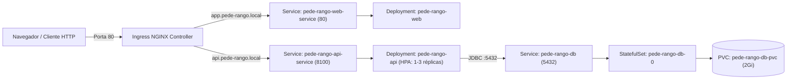

# ☸️ Pede-Rango — Infraestrutura Kubernetes (Kind & Helm)

Este diretório/repositório centraliza toda a **Infraestrutura como Código (IaC)** do ecossistema **Pede-Rango**, incluindo a configuração do cluster Kubernetes local via **Kind**, os **Helm Charts** de cada serviço (`pede-rango-api` e `pede-rango-web`), o provisionamento do banco **PostgreSQL 16** com persistência em volume (`StatefulSet` + `PVC`), auto-scaling horizontal (`HPA`) e roteamento de borda via **Ingress NGINX**.

---

## 📂 Estrutura de Diretórios

```text
pede-rango-infra/
├── README.md                    # Documentação técnica e guia operacional completo
├── kind/
│   └── kind-config.yaml         # Definição do nó Control-Plane do Kind (Portas 80/443 e label ingress-ready)
├── charts/
│   ├── pede-rango-api/          # Helm Chart do Backend + Banco de Dados PostgreSQL
│   │   ├── Chart.yaml
│   │   ├── values.yaml          # Configurações de imagem, probes, resources, HPA e banco
│   │   └── templates/
│   │       ├── api-deployment.yaml
│   │       ├── api-hpa.yaml
│   │       ├── api-ingress.yaml
│   │       ├── api-service.yaml
│   │       ├── db-pvc.yaml
│   │       ├── db-service.yaml
│   │       ├── db-statefulset.yaml
│   │       └── secret.yaml
│   └── pede-rango-web/          # Helm Chart do Frontend Web (React + Vite + Nginx)
│       ├── Chart.yaml
│       ├── values.yaml          # Configurações de imagem, réplicas, resources e Ingress
│       └── templates/
│           ├── web-deployment.yaml
│           ├── web-ingress.yaml
│           └── web-service.yaml
└── scripts/
    ├── setup-cluster.sh         # Provisiona o cluster do zero (Kind + Ingress + Metrics + Helm)
    ├── deploy-all.sh            # Compila as imagens Docker (API + Web), carrega no Kind e aplica rollout
    └── teardown-cluster.sh      # Destrói o cluster local quando necessário
```

---

## 🏗️ Arquitetura no Cluster Kubernetes



### Componentes Provisionados
| Componente | Tipo K8s | Nome no Cluster | Porta | Descrição |
| :--- | :--- | :--- | :--- | :--- |
| **PostgreSQL 16** | `StatefulSet` + `PVC` | `pede-rango-db` (`pede-rango-db-0`) | `5432` | Banco de dados relacional com volume persistente de `2Gi` |
| **Pede-Rango API** | `Deployment` + `HPA` | `pede-rango-api` | `8100` | API Spring Boot 3 / Java 21 com `initContainer` (`wait-for-db`), Flyway e probes |
| **Pede-Rango Web** | `Deployment` | `pede-rango-web` | `80` | Aplicação React servida via Nginx Alpine |
| **Ingress API** | `Ingress` | `pede-rango-api-ingress` | `80` | Roteia `api.pede-rango.local` e `api.192.168.3.27.nip.io` |
| **Ingress Web** | `Ingress` | `pede-rango-web-ingress` | `80` | Roteia `app.pede-rango.local` e `app.192.168.3.27.nip.io` |

---

## ⚙️ Pré-requisitos

1. **Ferramentas instaladas**:
   - `docker`
   - `kind`
   - `kubectl`
   - `helm`
2. **Configuração do `/etc/hosts`**:
   Certifique-se de que os domínios locais apontam para `127.0.0.1` no arquivo `/etc/hosts`:
   ```text
   127.0.0.1 api.pede-rango.local
   127.0.0.1 app.pede-rango.local
   ```

---

## 🚀 Guia Rápido (Subindo Tudo Automatizado)

Para levantar toda a infraestrutura do zero e publicar as aplicações com apenas **2 comandos**:

```bash
cd /home/nathan-nicolau/Documentos/Projetos/pede-rango-infra

# 1. Cria o cluster Kind, instala Ingress NGINX, Metrics Server e aplica os Helm Charts
./scripts/setup-cluster.sh

# 2. Compila o código (API + Web), gera imagens Docker, importa no Kind e faz rollout
./scripts/deploy-all.sh
```

---

## 🛠️ Guia Passo a Passo Manual (Comandos Detalhados)

Caso deseje executar cada etapa manualmente para fins de inspeção ou demonstração técnica:

### Passo 1: Criar o Cluster Kind
```bash
kind create cluster --name meu-cluster-local \
  --config /home/nathan-nicolau/Documentos/Projetos/pede-rango-infra/kind/kind-config.yaml
```

### Passo 2: Instalar o Ingress NGINX Controller
```bash
kubectl apply -f https://raw.githubusercontent.com/kubernetes/ingress-nginx/main/deploy/static/provider/kind/deploy.yaml

# Aguardar o pod do controlador Ingress ficar pronto
kubectl wait --namespace ingress-nginx \
  --for=condition=ready pod \
  --selector=app.kubernetes.io/component=controller \
  --timeout=180s
```

### Passo 3: Instalar o Metrics Server (Suporte ao HPA)
```bash
kubectl apply -f https://github.com/kubernetes-sigs/metrics-server/releases/latest/download/components.yaml

kubectl patch -n kube-system deployment metrics-server --type=json \
  -p '[{"op":"add","path":"/spec/template/spec/containers/0/args/-","value":"--kubelet-insecure-tls"}]'
```

### Passo 4: Instalar / Atualizar os Helm Charts
```bash
# Instalar Chart da API + PostgreSQL
helm upgrade --install pede-rango-api /home/nathan-nicolau/Documentos/Projetos/pede-rango-infra/charts/pede-rango-api

# Instalar Chart do Frontend Web
helm upgrade --install pede-rango-web /home/nathan-nicolau/Documentos/Projetos/pede-rango-infra/charts/pede-rango-web
```

### Passo 5: Compilar Imagens e Atualizar os Pods
```bash
# Opção A: Usando o atalho global configurado no ~/.bashrc
deploy-rango

# Opção B: Executando o script de cada projeto individualmente
cd /home/nathan-nicolau/Documentos/Projetos/pede-rango-api && ./deploy-local.sh
cd /home/nathan-nicolau/Documentos/Projetos/pede-rango-web && ./deploy-local.sh
```

---

## 🌐 Acessos e Credenciais de Demonstração

### URLs da Aplicação
- **Aplicação Web (Frontend)**: [http://app.pede-rango.local](http://app.pede-rango.local)
- **Healthcheck da API**: [http://api.pede-rango.local/actuator/health](http://api.pede-rango.local/actuator/health)
- **OpenAPI JSON (Docs)**: [http://api.pede-rango.local/v3/api-docs](http://api.pede-rango.local/v3/api-docs)

### Credenciais Padrão (Seed Automático via Flyway `V3`)
*Senha padrão para todos os perfis: **`123456`***

| Perfil | E-mail | Escopo de Uso |
| :--- | :--- | :--- |
| **ADMIN** | `admin@pederango.com` | Dashboard executivo BI, configurações da loja, gestão de cardápio, entregadores e usuários |
| **RESTAURANTE** | `restaurante@pederango.com` | Controle de expediente, fila de pedidos em tempo real, alerta sonoro e impressão de comanda |
| **ENTREGADOR** | `entregador@pederango.com` | Gestão de entregas atribuídas, saída para entrega, conclusão e contato rápido via WhatsApp |
| **CLIENTE** | `cliente@pederango.com` | Navegação no cardápio, criação/repetição de pedidos, acompanhamento em tempo real e avaliação ⭐ |

---

## 🔍 Comandos Úteis de Monitoramento e Diagnóstico

```bash
# Listar releases do Helm instaladas
helm list

# Verificar status de todos os recursos no namespace default
kubectl get pods,svc,ingress,pvc,hpa

# Acompanhar logs em tempo real
kubectl logs -f -l app=pede-rango-api
kubectl logs -f -l app=pede-rango-web
kubectl logs -f -l app=pede-rango-db

# Testar resposta HTTP via terminal
curl -I http://app.pede-rango.local
curl -s http://api.pede-rango.local/actuator/health

# Reiniciar deployments manualmente
kubectl rollout restart deployment/pede-rango-api
kubectl rollout restart deployment/pede-rango-web

# Destruir o cluster Kind completamente quando desejar liberar recursos
./scripts/teardown-cluster.sh
```
