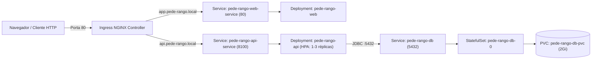

# ☸️ Pede-Rango — Infraestrutura & Guia de Execução (Docker, Kind & Helm)

Este repositório centraliza a **Infraestrutura como Código (IaC)** e os guias operacionais do ecossistema **Pede-Rango**, permitindo que desenvolvedores e avaliadores técnicos executem o sistema em **3 modos distintos**, de acordo com a preferência:

1. **🟢 Modo 1 (Direto na IDE / Terminal — Sem Kubernetes)**: Apenas o container do PostgreSQL rodando via Docker + Backend (IDE ou Maven) e Frontend (Vite) rodando separadamente.
2. **🔵 Modo 2 (Full Docker Compose — Sem Kubernetes)**: Banco de Dados + Backend API + Frontend Web rodando inteiramente em containers Docker.
3. **🟣 Modo 3 (Cluster Kubernetes Local — Kind + Helm)**: Topologia completa Cloud-Native com `StatefulSet`, `PVC`, `HPA`, `Probes` e roteamento via `Ingress NGINX`.

| Modo de Execução | Onde roda o Banco | Onde roda a API | Onde roda o Web | URL do Web | URL da API |
| :--- | :--- | :--- | :--- | :--- | :--- |
| **🟢 Modo 1 (IDE / Dev)** | Container (`:5433`) | IDE / Maven (`:8100`) | Vite Dev (`:5173`) | `http://localhost:5173` | `http://localhost:8100` |
| **🔵 Modo 2 (Docker Compose)** | Container (`:5433`) | Container (`:8100`) | Container (`:3000`) | `http://localhost:3000` | `http://localhost:8100` |
| **🟣 Modo 3 (Kubernetes Kind)** | Pod `StatefulSet` | Pod `Deployment` | Pod `Deployment` | `http://app.pede-rango.local` | `http://api.pede-rango.local` |

---

## 📂 Estrutura de Diretórios Esperada

Para que os scripts de automação e o `docker-compose.yaml` funcionem automaticamente, clone os três repositórios lado a lado dentro de uma mesma pasta raiz:

```text
Projetos/
├── pede-rango-api/              # Repositório Backend (Spring Boot 3 + Java 21 + Flyway)
├── pede-rango-web/              # Repositório Frontend (React 19 + Vite)
└── pede-rango-infra/            # Este repositório (Docker Compose + Kind + Helm Charts)
    ├── README.md
    ├── docker-compose.yaml      # Orquestração rápida sem Kubernetes (DB + API + Web)
    ├── kind/
    │   └── kind-config.yaml     # Configuração do nó Control-Plane do Kind (Portas 80/443)
    ├── charts/
    │   ├── pede-rango-api/      # Helm Chart da API + StatefulSet PostgreSQL + HPA + Secrets
    │   └── pede-rango-web/      # Helm Chart do Frontend Web + Service + Ingress
    └── scripts/
        ├── setup-cluster.sh     # Provisiona o cluster K8s do zero (Kind + Ingress + Metrics + Helm)
        ├── deploy-all.sh        # Compila as imagens (API + Web), carrega no Kind e aplica rollout
        └── teardown-cluster.sh  # Destrói o cluster Kind local para liberar recursos
```

---

## 🟢 Modo 1: Execução Local Separada (Apenas o Banco no Docker)

Ideal para rodar, testar ou depurar a **API** e o **App Web** diretamente no terminal ou IDE, **sem precisar de Kubernetes**.

> **Nota**: O Flyway cria todas as tabelas e insere a carga inicial de usuários e cardápio (`V1`, `V2`, `V3`) automaticamente assim que a API inicia!

### 1. Subir apenas o container do Banco de Dados (PostgreSQL 16)
A partir da pasta `pede-rango-infra` (ou `pede-rango-api`):
```bash
cd pede-rango-infra
docker compose up -d db
```
*(O PostgreSQL ficará disponível em `localhost:5433` com banco `pede_rango_db`, usuário `pede_rango_user` e senha `pede_rango_pass`).*

### 2. Iniciar a API Backend (Spring Boot — via IDE ou Terminal)
Você pode dar **Run / Debug** diretamente pela sua IDE (IntelliJ / VS Code / Eclipse) na classe `PedeRangoApiApplication`, ou executar pelo terminal:
```bash
cd ../pede-rango-api
./mvnw spring-boot:run
```
- **API disponível em**: [http://localhost:8100](http://localhost:8100)
- **Swagger UI**: [http://localhost:8100/swagger-ui.html](http://localhost:8100/swagger-ui.html)
- **Healthcheck**: [http://localhost:8100/actuator/health](http://localhost:8100/actuator/health)

### 3. Iniciar o App Web (React + Vite)
Em outro terminal, acesse a pasta do Frontend e execute:
```bash
cd ../pede-rango-web
npm install
npm run dev
```
- **Frontend Web disponível em**: [http://localhost:5173](http://localhost:5173) *(conecta-se automaticamente à API em `http://localhost:8100`)*.

---

## 🔵 Modo 2: Tudo via Docker Compose (Sem Kubernetes)

Caso deseje subir **Banco + API + Web** inteiramente em containers Docker (os `Dockerfiles` de ambos os projetos são *multi-stage* e já compilam o código automaticamente dentro do container):

```bash
cd pede-rango-infra
docker compose up -d --build
```

- **Frontend Web**: [http://localhost:3000](http://localhost:3000)
- **Backend API**: [http://localhost:8100](http://localhost:8100)
- **Para parar os containers**: `docker compose down`

---

## 🟣 Modo 3: Cluster Kubernetes Local (Kind + Helm + Ingress + HPA)

Para avaliar e validar a arquitetura completa em Kubernetes.



### Pré-requisitos (Modo Kubernetes)
1. Ferramentas instaladas: `docker`, `kind`, `kubectl`, `helm`.
2. Entradas no arquivo `/etc/hosts` apontando para `127.0.0.1`:
   ```text
   127.0.0.1 api.pede-rango.local
   127.0.0.1 app.pede-rango.local
   ```
3. Certifique-se de que as portas `80` e `443` da máquina host estão livres.

### ⚡ Opção A: Inicialização Automatizada (2 Comandos)
```bash
cd pede-rango-infra

# 1. Cria o cluster Kind, instala Ingress NGINX, Metrics Server e instala os Helm Charts
./scripts/setup-cluster.sh

# 2. Compila API e Web, gera imagens Docker, importa no Kind e realiza o rollout
./scripts/deploy-all.sh
```

### 🛠️ Opção B: Passo a Passo Manual Detalhado
```bash
cd pede-rango-infra

# 1. Criar o cluster Kind local
kind create cluster --name meu-cluster-local --config ./kind/kind-config.yaml

# 2. Instalar o Ingress NGINX Controller e aguardar ficar Ready
kubectl apply -f https://raw.githubusercontent.com/kubernetes/ingress-nginx/main/deploy/static/provider/kind/deploy.yaml
kubectl wait --namespace ingress-nginx \
  --for=condition=ready pod \
  --selector=app.kubernetes.io/component=controller \
  --timeout=180s

# 3. Instalar o Metrics Server (para funcionamento do HPA)
kubectl apply -f https://github.com/kubernetes-sigs/metrics-server/releases/latest/download/components.yaml
kubectl patch -n kube-system deployment metrics-server --type=json \
  -p '[{"op":"add","path":"/spec/template/spec/containers/0/args/-","value":"--kubelet-insecure-tls"}]'

# 4. Instalar os Helm Charts (API + Banco PostgreSQL + Frontend Web)
helm upgrade --install pede-rango-api ./charts/pede-rango-api
helm upgrade --install pede-rango-web ./charts/pede-rango-web

# 5. Compilar, importar imagens no Kind e reiniciar deployments
(cd ../pede-rango-api && ./deploy-local.sh)
(cd ../pede-rango-web && ./deploy-local.sh)
```

### Acessos no Modo Kubernetes
- **Aplicação Web**: [http://app.pede-rango.local](http://app.pede-rango.local)
- **API Healthcheck**: [http://api.pede-rango.local/actuator/health](http://api.pede-rango.local/actuator/health)
- **OpenAPI JSON**: [http://api.pede-rango.local/v3/api-docs](http://api.pede-rango.local/v3/api-docs)

---

## 🔐 Credenciais de Acesso (Todos os Modos)

*Senha padrão para todos os perfis: **`123456`***

| Perfil | E-mail | Escopo de Uso |
| :--- | :--- | :--- |
| **ADMIN** | `admin@pederango.com` | Dashboard executivo BI, configurações da loja, gestão de cardápio, entregadores e usuários |
| **RESTAURANTE** | `restaurante@pederango.com` | Controle de expediente, fila de pedidos em tempo real, alerta sonoro e impressão de comanda |
| **ENTREGADOR** | `entregador@pederango.com` | Gestão de entregas atribuídas, saída para entrega, conclusão e contato rápido via WhatsApp |
| **CLIENTE** | `cliente@pederango.com` | Navegação no cardápio, criação/repetição de pedidos, acompanhamento em tempo real e avaliação ⭐ |

---

## 🔍 Comandos Úteis de Monitoramento e Limpeza

```bash
# Verificar status no Kubernetes
helm list
kubectl get pods,svc,ingress,pvc,hpa

# Logs em tempo real no Kubernetes
kubectl logs -f -l app=pede-rango-api
kubectl logs -f -l app=pede-rango-web
kubectl logs -f -l app=pede-rango-db

# Remover o cluster Kind completamente
./scripts/teardown-cluster.sh
```
